# HaqSetu — System Architecture

This document describes how HaqSetu is put together: the components, how a request flows through them, how the voice assistant works, the data model, and how it is deployed.

- [1. High-level overview](#1-high-level-overview)
- [2. Components](#2-components)
- [3. Eligibility engine](#3-eligibility-engine)
- [4. Request flow: finding schemes](#4-request-flow-finding-schemes)
- [5. Voice assistant flow](#5-voice-assistant-flow)
- [6. Data model](#6-data-model)
- [7. Scheme catalogue lifecycle](#7-scheme-catalogue-lifecycle)
- [8. Security architecture](#8-security-architecture)
- [9. Deployment](#9-deployment)
- [10. Design decisions](#10-design-decisions)

---

## 1. High-level overview

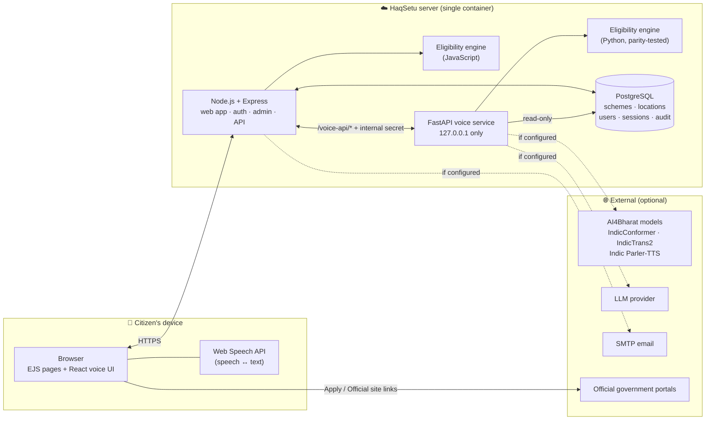

HaqSetu is a server-rendered web application with one interactive React island (the voice assistant). A Python service handles voice conversations beside it. Both read the same PostgreSQL database and use the same eligibility rules.

## 2. Components

| Component | Tech | Responsibility |
|---|---|---|
| **Web app** | Node.js 22, Express, EJS | Public pages, scheme search, quick check, accounts, dashboard, admin console, proxy for the voice service |
| **Eligibility engine (JS)** | `src/eligibility.js` | Deterministic, explainable matching of a profile against scheme rules |
| **Voice UI** | React 18, Vite | Language picker, mic/recording states, editable transcript, audio controls, result cards, consent buttons |
| **Voice service** | Python, FastAPI, asyncpg, httpx | Conversation management, information extraction, provider adapters |
| **Eligibility engine (Py)** | `voice/engine.py` | Port of the JS engine; parity-tested on every build |
| **Provider adapters** | `voice/providers/*` | Separate modules for speech recognition, translation, LLM and speech synthesis — each with timeouts, retries and a text fallback |
| **Database** | PostgreSQL | Schemes (JSONB rules, full-text search), states/districts/sub-divisions, users, profiles, consents, sessions, revisions, audit log |
| **Catalogue updater** | Scheduled weekly job | Researches official sources and ships scheme additions/changes as commits |

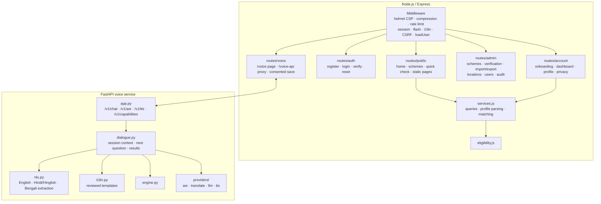

## 3. Eligibility engine

Every scheme stores its eligibility conditions as a JSON rule tree. The engine evaluates each condition to **true**, **false** or **unknown** (when the citizen hasn't provided that detail) and combines them:

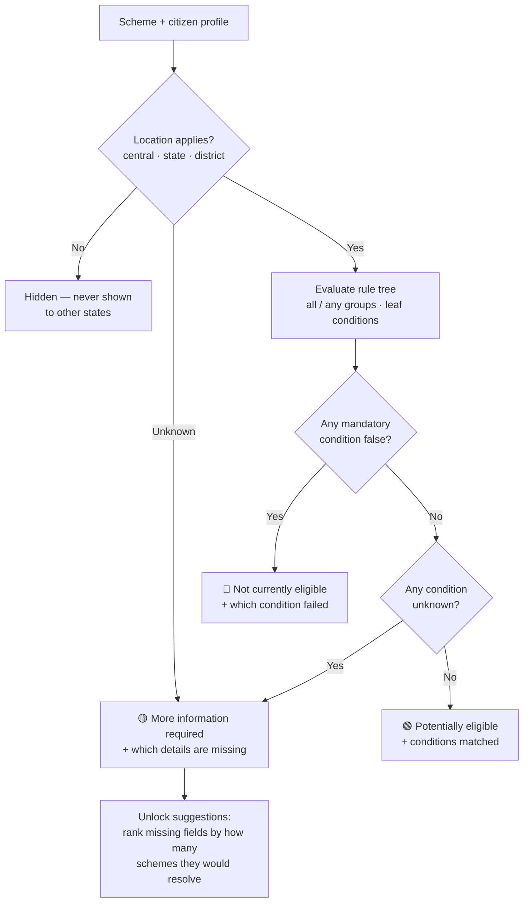

Rule example (Atal Pension Yojana):

```json
{ "all": [
  { "field": "age", "op": "between", "value": [18, 40] },
  { "field": "has_bank_account", "op": "is", "value": true },
  { "field": "is_income_tax_payer", "op": "is", "value": false }
] }
```

Supported operators: `gte gt lte lt between eq neq in nin level_gte level_lte is manual`. Two extra modifiers keep results honest:

- **`manual`** — a condition that can't be checked online (e.g. "above 80th percentile in your board") always shows as *needs verification*.
- **`falseIsUnknown`** — for proxy conditions (e.g. a BPL card as a stand-in for the SECC list), a "no" means "check officially", not "rejected".

No language model participates in eligibility decisions.

## 4. Request flow: finding schemes

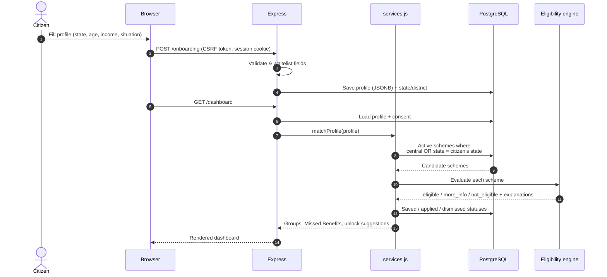

## 5. Voice assistant flow

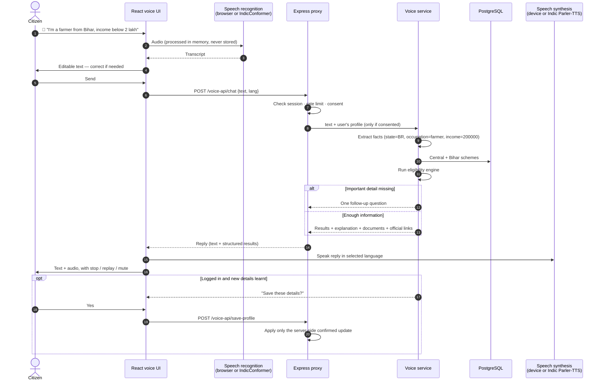

**Fallback chain for every step:**

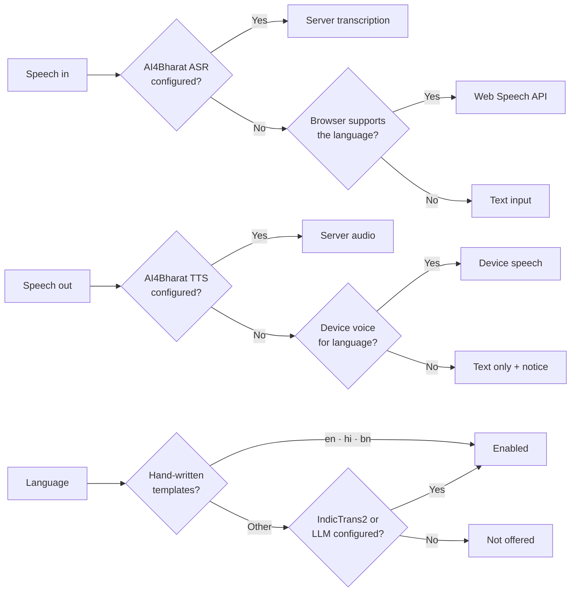

## 6. Data model

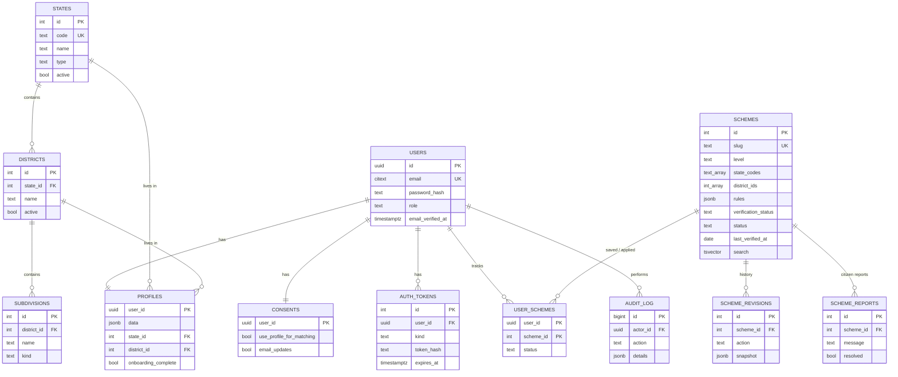

Notes:
- Profile details live in a whitelisted **JSONB** document, so new eligibility fields can be added without migrations.
- Scheme rules are **JSONB**; geography is `state_codes[]` + `district_ids[]` with GIN indexes; search uses a weighted **tsvector**.
- Passwords are bcrypt hashes; reset/verification tokens are stored only as SHA-256 hashes.

## 7. Scheme catalogue lifecycle

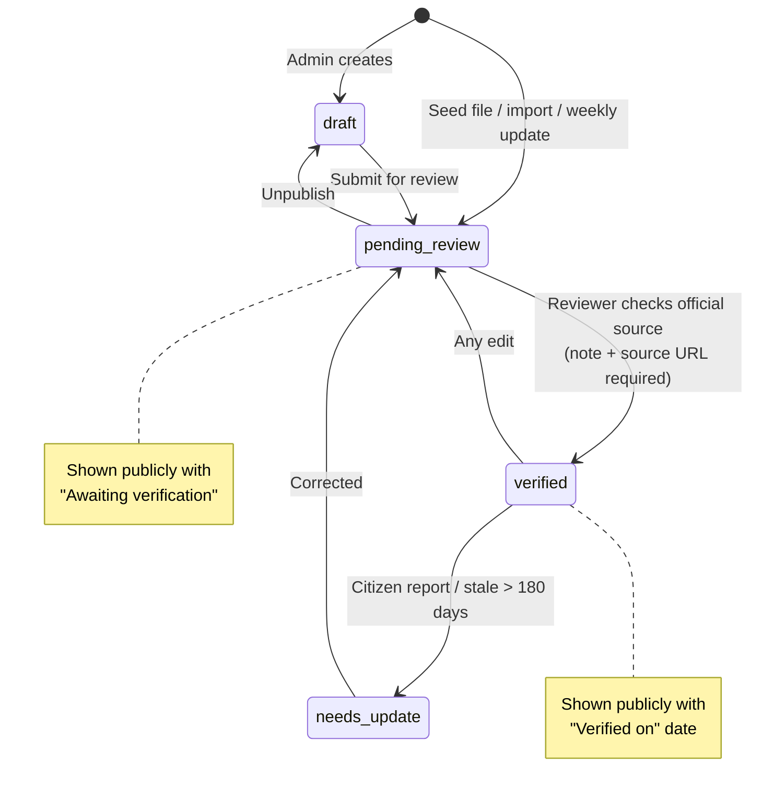

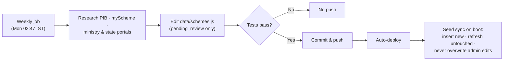

## 8. Security architecture

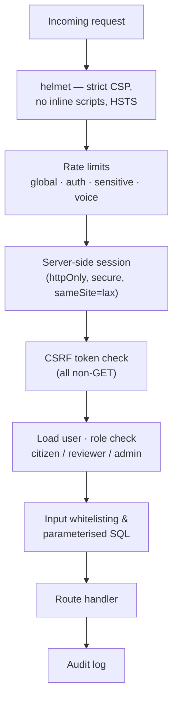

| Concern | Measure |
|---|---|
| Passwords | bcrypt (12 rounds), policy check, lockout after 8 failures |
| Sessions | Stored in PostgreSQL, regenerated on login, all sessions revoked on password reset |
| Tokens | Random 256-bit, stored hashed, single-use, short expiry |
| Enumeration | Identical responses for unknown emails; constant-time login path |
| Personal data | Never collects Aadhaar, bank details or OTPs; export + hard delete; consent gates matching |
| Voice | No audio stored; voice service bound to localhost with a per-boot secret; profile saves need a server-side confirmation |
| Secrets | Model/API keys only in server environment, never sent to the browser |

## 9. Deployment

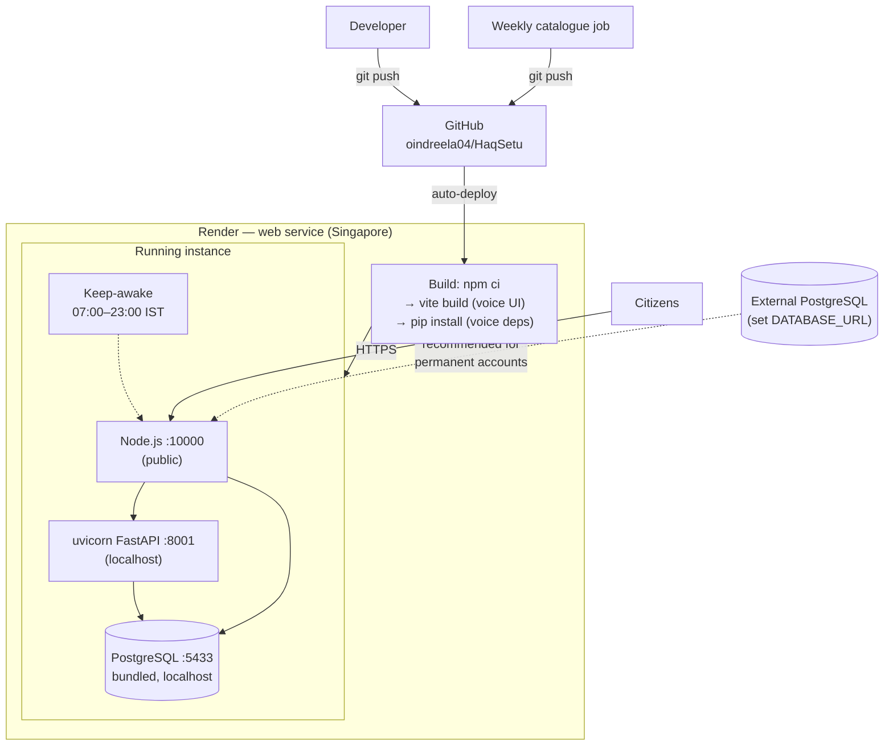

| Mode | When | Persistence |
|---|---|---|
| **Bundled PostgreSQL** | `DATABASE_URL` not set | Private to the instance; resets on restart (a site banner says so) |
| **External PostgreSQL** | `DATABASE_URL` set | Permanent; bundled database is not started |

Startup sequence: start bundled PostgreSQL (if needed) → run migrations → seed locations and sync schemes → start the voice service → start Express → begin keep-awake.

## 10. Design decisions

| Decision | Why |
|---|---|
| **Deterministic rules, not an LLM, for eligibility** | Welfare decisions must be explainable and reproducible; every result lists exactly which conditions matched or failed. |
| **Server-rendered pages + one React island** | Fast first load on low-end phones and slow networks; React only where real-time interactivity is needed (voice). |
| **Two engines with parity tests** | Keeps the voice service independent while guaranteeing web and voice always agree. |
| **Pluggable provider adapters** | AI4Bharat models need GPUs and gated access; the assistant works today with browser speech and switches to Indic models by configuration, with no code changes. |
| **Three-state logic (true/false/unknown)** | Missing information should prompt a question, not a rejection. |
| **Scheme catalogue in code + database** | Seed data is versioned and reviewable in Git; admin edits in the database are protected from being overwritten. |
| **Location as data, not code** | States, districts and sub-divisions are database rows, so administrative changes need no deploy. |
